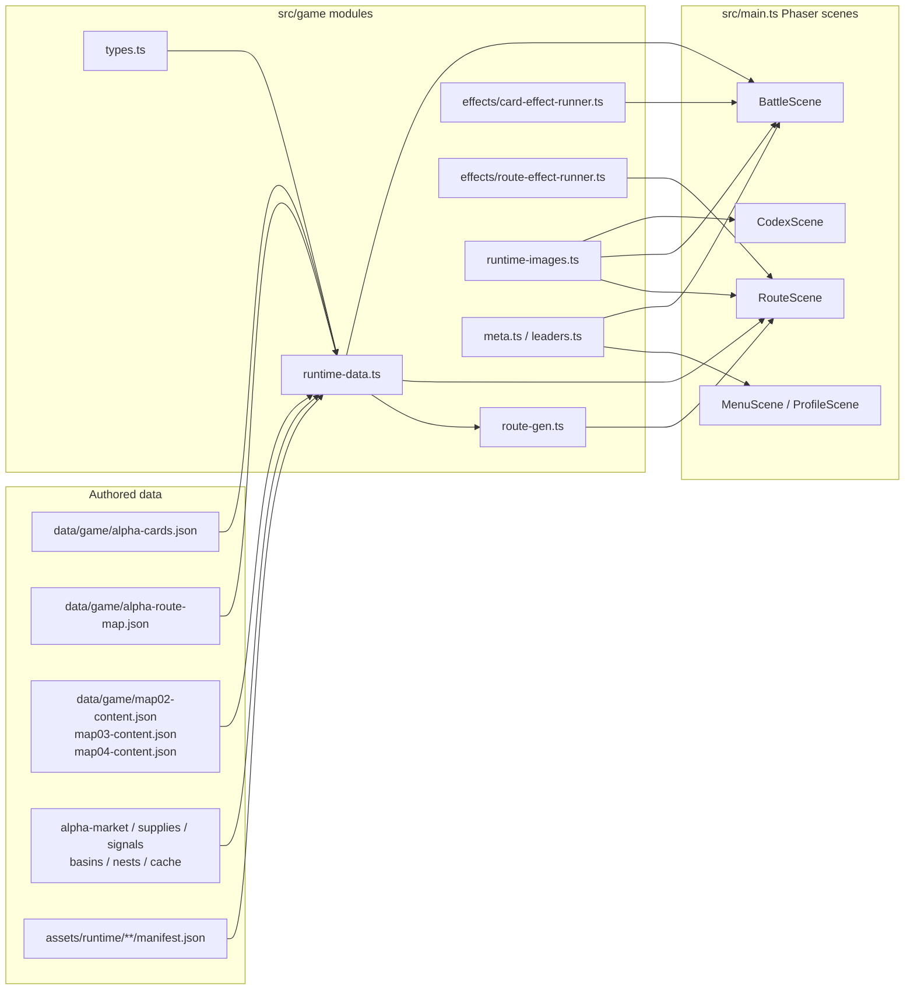
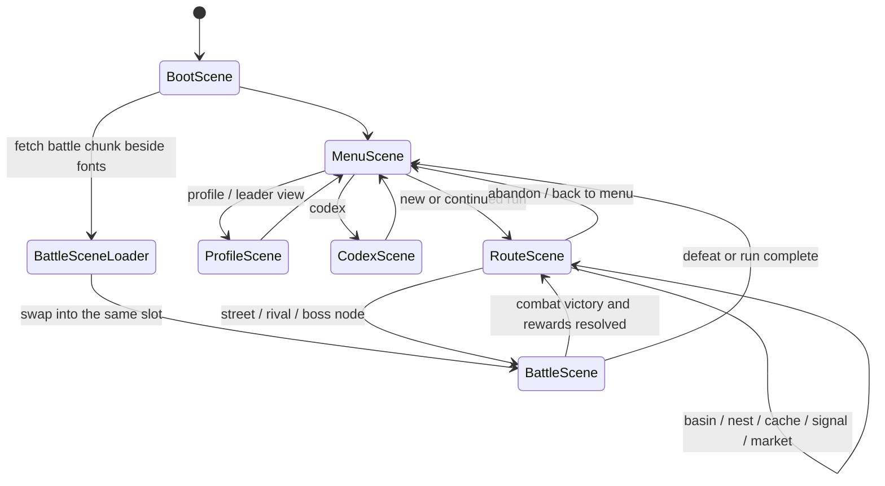
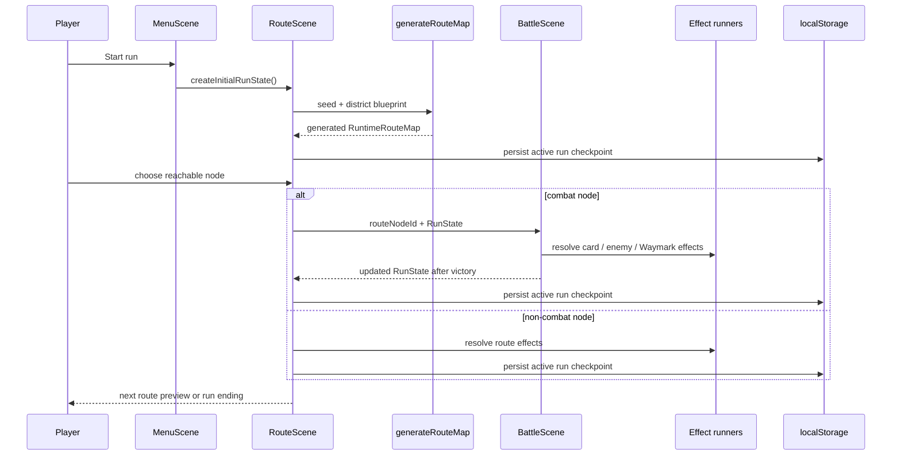
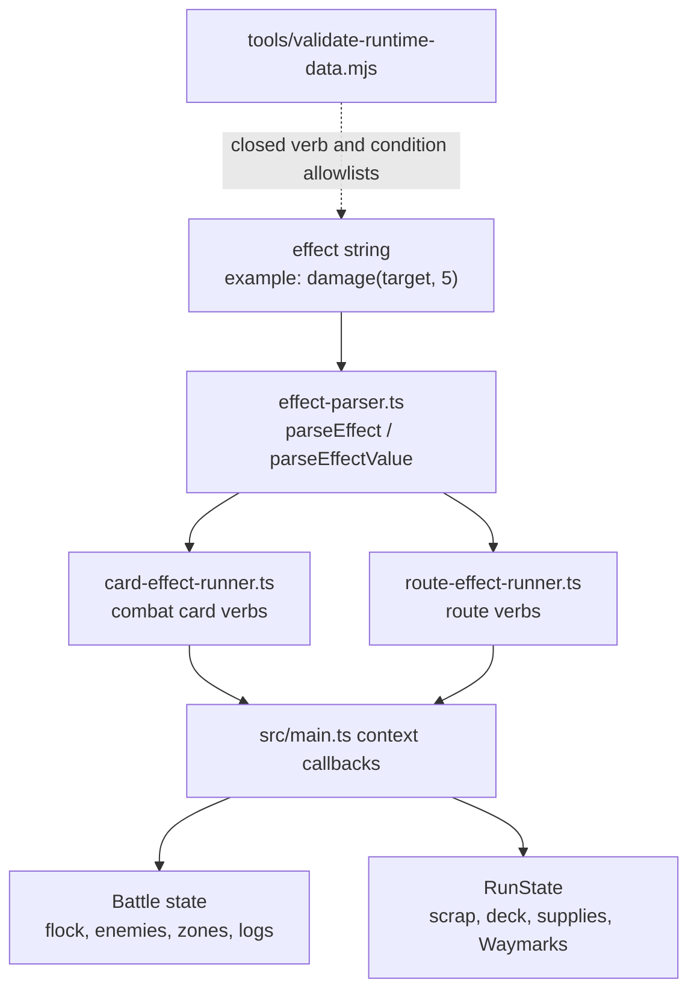
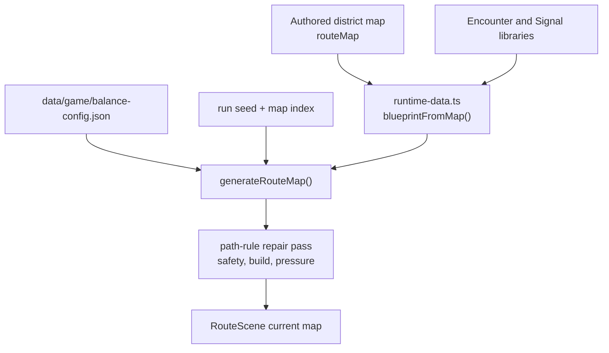
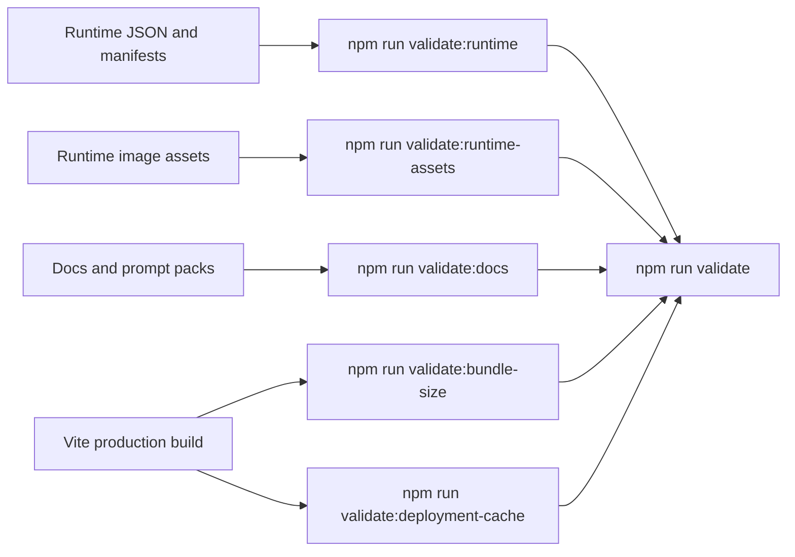

# Bird Squad Runtime Architecture

Status: current codebase map for implementation and documentation maintenance.

This note describes how the playable build is wired today. It is a companion to
the design specs, not a replacement for them:

- Game rules and player-facing terms: `docs/game/`
- Visual and art pipeline rules: `docs/art/`
- Runtime JSON contracts and validation: `data/game/`, `src/game/types.ts`,
  and `tools/validate-runtime-data.mjs`
- Phaser scene implementation: `src/main.ts`

## Current Snapshot

| Area | Current shape |
| --- | --- |
| Runtime framework | Phaser 4 through Vite. |
| Main scene file | `src/main.ts`, with helper modules under `src/game/`. |
| Districts | 4 playable maps: Rooftop Blocks, Canal Markets, Signal Spires, High Roost. |
| Runtime cards | 110 total: 100 playable cards plus 10 Snags. |
| Starter / reward cards | 10 starter cards, 90 reward-pool cards. |
| Enemies / encounters | 64 enemies, 80 encounters. Encounters can spawn up to 4 enemies. |
| Signals / Supplies / Waymarks | 38 Signals, 31 Supplies, 58 Waymarks. |
| Route maps | Authored district maps feed seeded generated maps per run. |
| Persistence | Active run, account unlocks, and run summaries use `localStorage`. |
| Test harness | `window.__birdSquadState()` and `render_game_to_text()` drive Playwright smoke tests. |
| Presentation | Lazy `src/game/spectacle/` for lighting, weather and impact dressing; self-hosted Barlow and Fraunces UI faces. |

## Code And Data Flow

The important boundary is that JSON data names the cards, encounters, route
payloads, items, and art targets. The scene code resolves those names through
typed maps in `runtime-data.ts`, then delegates effect strings to small
interpreters instead of hardcoding most card or route outcomes directly.

## Scene Lifecycle

`RouteScene` owns path choice, non-combat node resolution, Market shelves,
Waymark/Supply drawers, card reward/preen/release pickers, and active-run
checkpoints. `BattleScene` owns combat state, hand/draw/discard zones, enemy
Tells, Supplies used in combat, Waymark combat triggers, rewards after victory,
and run-summary emission.

## Run Lifecycle

## Effect Resolution

Card effects and route effects intentionally share the same simple expression
shape, but they do not share the same verb set. `validate-runtime-data.mjs`
mirrors the runtime interpreters so a typo or unsupported verb fails validation
instead of silently doing nothing in game.

Current card-effect extensions beyond the original foundation set include
`damagePierce`, `removeCover`, `resonanceBurst`, `windedBurst`, `overhealCover`,
`loseCohesion`, `damageFlock`, `retainHand`, `gainEnergyNextTurn`,
`enemyNextAttackBonus`, `enemyGainCover`, `shuffleSelfToDraw`, and `exhaustSelf`.
Cards can also define `heldEffects`, `moltEffects`, and upgraded
`upgrade.moltEffects`.

## Route Generation

The authored maps are still useful content sources: they provide district IDs,
entry and boss payloads, and pools of combat/non-combat payloads. At runtime,
the generated map uses those pools plus `balance-config.json` to produce a
seeded graph with controlled pacing beats, non-combat relief, and boss access.

## Persistence And Player Backups

Four gameplay records are journaled in browser storage: the player account,
active flight, run history, and first-flight guide. Each primary has a mirrored
`.backup` checkpoint; malformed primaries can be quarantined as `.corrupt`
while the runtime recovers the last valid mirror. Controls, graphics, contrast,
motion, combat pace, music/SFX volume, mute state, and the highest unlocked tier
are stored as separate preferences.

Run history is treated as untrusted persisted input. The runtime scans a
bounded candidate set, validates each summary and its nested cards, route,
items, decisions, and results against owned runtime data, de-duplicates IDs
with the newest occurrence winning, and retains at most 50 valid flights.
`Flock Record -> Flight Log` presents all retained flights in seven-row pages
and can reconstruct the same complete `Flight Details` report used at the
outcome. Historical `Copy Flight Link` actions derive only the deterministic
seed and mode from the sanitized record.

`src/game/save-backup.ts` is the single full-backup boundary. It writes a
versioned `bird-squad-save` JSON document containing only the owned records and
preferences above. Restore accepts at most 2 MB, runs every section through the
same authoritative sanitizers used by the runtime, requires unique valid
control bindings, and stages a summary before the player can confirm. Applying
a restore replaces only the explicit Bird Squad key allowlist, rebuilds journal
mirrors, verifies each write, and attempts rollback from an in-memory snapshot
if any operation fails. It never reads, deletes, exports, or uploads unrelated
origin storage.

Players reach the flow through **Flock Record -> Save Data**. Backups are local
downloads and restores use a local file picker; there is no server sync or
network transport. This is a single-player recovery feature, not a
cryptographic anti-cheat boundary. The complete surface shares one focus order
across configurable keyboard bindings, Tab, pointer/touch, and D-pad/A/B
gamepad input; focus and legal actions are also exposed in Profile text state.

## Validation And Build Gates

Use `npm run validate` after changes to cards, runtime data, art manifests,
effect syntax, route systems, or mechanics docs. Use `npm run build` when code or
asset loading changes, because the production split and deployment-cache
contract are part of the shipped runtime.

## Maintenance Notes

- `src/main.ts` remains the largest maintenance risk. Prefer moving new generic
  logic into `src/game/` modules when it has a clear data or rules boundary.
- `data/game/alpha-cards.json` is now a broader runtime card file despite the
  historical `alpha` name. It includes the starter deck, reward pool, Legends,
  Crew, Aviary cards, the Molt signature card, and Snags.
- The player-facing term is `Waymarks`; the runtime field remains `routeMarks`
  for compatibility with existing save/run code.
- Snags are runtime-only cards. They are exempt from the tarot arcana source
  cross-check and do not need individual card art manifest entries.
- `CodexScene` lazy-loads extended codex data. Do not eagerly import that data
  into boot paths unless bundle budgets are intentionally revisited.
- `BattleScene` is its own lazy chunk (`battle-scene`, ~267 KB with the
  combat-only modules it alone imports). The boot config registers
  `BattleSceneLoader` (`src/scenes/battle-scene-loader.ts`) under the
  `BattleScene` key; `BootScene` fetches the real chunk beside the UI fonts and
  swaps it into the same Scene Manager slot, so `scene.start('BattleScene')`
  from anywhere (including tests calling the manager directly) reaches the real
  scene. A start that wins the race keeps its data, shows a short loading card
  (`mode: 'battleLoading'`) and hands off; a failed fetch offers a retry
  (`mode: 'battleLoadFailed'`). Tests that need the real instance synchronously
  call `await __birdSquadEnsureScene('BattleScene')` first. Import
  `BattleScene` as a type only outside `battle-scene.ts`.
- Presentation pace: Animation Pace and Fast Mode multiply scene tweens,
  sprite animation, retained actors and set pieces through
  `animationPaceTimeScale()`; Fast Mode also shortens `combatTimingDelay` and
  holds Hustle through enemy turns after each beat's readable minimum. None of
  it touches rules or `advanceTime`, which still steps real game milliseconds.
  Pure rules: `src/game/pace-rules.ts`.
- Rumble: `src/game/haptics.ts` (browser glue, Rumble setting, Screen
  Shake gate) over `src/game/haptic-dispatch.ts` (pure, unit-tested). Heavy
  hits, Surge and finishing blows pulse Gamepad `vibrationActuator` and, on
  touch-first devices, `navigator.vibrate`; every path is a safe no-op.
- Optional route presentation is split by interaction: Flock Stats lives in
  `src/game/flock-stats-overlay.ts`; card hover, Deck Review detail, and market
  dossiers live in `src/game/card-hover-detail.ts`; the pinned Deck Review
  side-by-side renderer lives in `src/game/card-comparison.ts` and loads only
  after the first comparison is pinned; the Deck Review browser shell, controls,
  index, and navigation live in `src/game/route-deck-browser.ts`; owned Waymark
  drawer, trigger/effect-order review, and pinned comparison live in
  `src/game/waymark-review.ts`; the Supply drawer lives in
  `src/game/route-supply-drawer.ts`; the post-choice Route reward review lives
  in `src/game/route-reward-overlay.ts`; system confirmations and settings live
  in `src/game/system-overlays.ts`. Route's automation/accessibility snapshot lives in
  `src/game/route-debug-state.ts` and loads when RouteScene opens instead of on
  the title screen. Keep these modules out of title-screen modulepreloads and
  preserve their retry/fallback behavior when extending them.
- Screen-reader preference and state remain synchronous in
  `src/game/screen-reader-accessibility.ts`; polling and live announcements are
  opt-in through `src/game/screen-reader-runtime.ts`, which then loads
  `screen-reader-summary.ts`. Keep both runtime modules off the default
  title-screen preload path.
- Generated/source art belongs under `.generated/`; optimized runtime assets
  belong under `assets/runtime/` and should be referenced through manifests or
  Vite-managed imports.

## Spectacle boundary

`src/game/spectacle/` is lazy presentation that never changes game state. It
loads beside the game (`installSpectacle` in `main.ts`), and boot waits for it
together with the UI fonts, capped at 1.5 seconds.

- `stage.ts`: adopts scenes as they are created. Battle gets per-district
  lights and weather on its own layer above the backdrop, bloom and grade on
  the backdrop, a targeting arc and an outcome grade. Title and route get
  rain, glow and bloom. Every scene gets an arrival sweep and film grain.
- `punch.ts`: camera punch, edge flashes and the defeat stagger.
- `impact.ts`: suit-shaped impacts, feathers, impact light, block sparks,
  rising motes, danger lines and floor marks, on layers it owns.

Two global patches live in `stage.ts` and affect every scene:

- `roundPanels` rounds rectangles created through the factory, except
  hairlines, meters and full-screen shades.
- `keepAuthoredLineMetrics` gives text in the new faces the line metrics of
  its system fallback; see `docs/game/visual-spectacle.md`.

Gates: Lean graphics removes stage dressing; Reduced Motion keeps still
lighting only; shader passes and film grain need hardware WebGL (`?fx=full`
forces them on, `?fx=off` off). WebKit masks its renderer string, so the
software check does not catch it. Never put a non-solid page background behind
the canvas: WebKit recomposites it every frame.

## Retained battle actors

`BattleScene.renderAll()` still rebuilds its `root` container on every state
change. Three kinds of object no longer take part in that rebuild: enemy
bodies, the flock body and hand cards. They are **actors**, owned by one
`BattleActorStage` per scene (`src/game/battle/actors.ts`, lazy chunk
`battle-actors`, reached through `battleActors(scene)` or `scene.battleActors`).

Every actor has two halves, and code must not mix them:

- **Logical slot**: where layout put it (`actor.slot`). Hit areas, forecasts,
  the targeting arc, `getBounds()` and every layout test read this. Animation
  never writes it.
- **Visual pose**: `actor.pose`, an offset, scale, tilt and flash relative to
  the slot. Only drawing reads it.

How each kind is retained:

| Actor | Id | Retained object | Pose applied by | Hit area |
| --- | --- | --- | --- | --- |
| Enemy body | `enemy:<enemy id>` | `combat-enemy-art` container | the stage sets the container's position, scale and angle | `combat-enemy-hit`, a slot rectangle in `root` |
| Flock body | `flock` | `combat-leader-art` container | same | `combat-leader-hit`, a slot rectangle in `root` |
| Hand card | `card:<instance id>` | the card's flat objects in `handLayer` | `attachCardBody` multiplies the pose into the parent matrix while each object is drawn | the card's own rectangle (`handCardRects`), never moved |

A hand card that leaves the hand for a pile is released from its actor and
travels as an ordinary container; see Cards as objects below.

- Combatant bodies are parked by `parkBattleActors(root)` just before the
  immediate layer is cleared and re-seated in draw order by
  `renderBattleForeground`. A body is refilled only when its art signature
  changes and destroyed when it is not drawn in a pass.
- `renderBattleHand` reconciles: an unchanged face keeps its objects, a card
  whose slot moved is shifted and slides, a changed face is redrawn, a card
  that left the hand is destroyed. Card objects keep logical transforms at all
  times, so their bounds are the layout contract.
- Enemy portraits report visual bounds (they are inside the animated
  container); that keeps the breathing-envelope and HUD-clearance checks honest.
- `combat-leader-pose` inside the flock body still belongs to
  `living-performances.ts`; the stage animates the container around it.

The actor clock (`stage.time`) follows `scene.time.now`, so the manual
`advanceTime` clock drives it (`advanceGameTime` emits `clock-advanced` per
manual frame). It scales with Animation Pace, holds every pose at identity
under Reduced Motion, and `hitStop(frames)` freezes it for 2–4 frames without
touching scene timers or tweens. Stagger judder follows Screen Shake and the
hit flash follows Flash Effects.

To animate an actor:

- `stage.play(id, motion)`: a transient keyframed `ActorMotion`. `action`
  motions replace each other and blend out; `react` motions layer on top.
- `actor.rest`: a persistent target the pose eases toward (the hand fan and
  hover lift are written in `layoutHand`).
- `stage.ensure(id, kind, x, y)` / `bindNode(...)`: move the slot; the drawn
  hand card slides from where it was; a combatant body takes the slot at once.
- The scene announces events and the stage chooses the motion:
  `queueEnemyMotion(id, 'windup' | 'attack' | 'hit', detail)` and
  `queueFlockMotion(cue, detail)` emit `living-enemy-cue` / `living-flock-cue`;
  `living-cast` starts the flock dive. `detail` is the damage of a hit.
- `stage.debugState()` reports every actor's slot, pose and running motions;
  `stage.visualPoint(id)` is where a body is drawn now.

Still immediate-mode: the top bar and HUD, enemy vitals, intent, rank and
status panels (their icons and ghost bars are retained by combat life, below), contact shadows, the target reticle and guide, the selection
preview, hand pager and all overlays and ceremonies. The hand's compact
fallback renderer (used when the lazy renderer fails) is neither retained nor
animated.

### Cards as objects

`src/game/battle/card-objects.ts` (lazy chunk `battle-card-objects`, with the
pure rules in `card-object-rules.ts`) owns what a card does when it is not
sitting in its slot. One `CardObjectStage` per scene, reached through
`cardObjects(scene)` or `scene.cardObjects`; it is created by the first hand
render, so the scene always calls it as `this.cardObjects?.…` and keeps the old
card-back transfers as the fallback. It decides nothing: every play goes
through `onCardClicked` / `onEnemyClicked`, and no logical slot is written.

| Moment | What moves | Where | Driven by |
| --- | --- | --- | --- |
| Play | `combat-card-cast-ghost`, a small illustrated card, thrown from the hand card's drawn position to its target | `fxLayer` (as before) | one scene tween that ends with the existing resolve delay |
| After landing | `combat-card-departing` (`played`), the same small card, to the discard pile, the draw pile, or burned | the stage's own layer `combat-card-objects` (depth 31) | scene tweens |
| Draw, and the opening hand once the intro clears | the hand card itself, from the draw pile to its slot, staggered | `handLayer`, as a `deal` actor motion | the actor clock |
| Discard, end of turn | the hand card's own objects, re-parented into one `combat-card-departing` body | `combat-card-objects` | scene tweens |
| Cleared for the combat | the same body, burned in place (`combat-card-burn-*`) | `combat-card-objects` | scene tweens |
| Drag | the hand card, through `stage.hand.dragged` | `handLayer` | the actor clock |
| Refusal | the hand card, a `deny` react motion | `handLayer` | the actor clock |

- **Landing targets:** an enemy for `enemy`, the middle of the living enemies
  for `allEnemies`, the flock for `self`, stage centre for `none` and `choice`.
  The arc's control point keeps the card's top edge below the top bar.
- **Timing is unchanged.** The ghost is still destroyed at the resolve delay;
  the trip to a pile happens in a layer the player-card FX window does not
  retire, and nothing waits for it.
- **Pile counters** show `stage.shownPileCount(pile)` while cards are in the
  air: a dealt card stays counted until it leaves the draw pile, a discard is
  counted when it arrives. `render_game_to_text` still reports the real piles.
- **Drag to play** arms on the press that selected a playable card
  (`armDrag`, called by the hand renderer after `onCardClick`). After 14 px of
  travel the card follows the pointer. Release over a valid target calls the
  same handler a second click would; release anywhere else returns the card and
  clears the selection that press made. A synthetic `pointerdown` without a
  held pointer never arms a drag. Under Reduced Motion the card stays in its
  slot and only the target brackets (`combat-drag-target`) show.
- **Rarity frames** are canvas textures drawn once per rarity and size
  (`addRarityFrame`); rare and legendary add a `TileSprite` sheen whose texture
  slides while its bounds stay fixed. Hand, reward and pile-inspect faces use
  it. No sheen under Reduced Motion or Lean graphics.
- **Number highlights** are small text overlays on the rules label
  (`combat-card-number-tint`); the label's text is never rewritten. Tones:
  `buff` and `reduced` compare `cardDamageOutcome` / `cardCoverOutcome` with
  and without current status (passive flock bonuses are excluded), `preen`
  marks numbers that differ from the unupgraded card. They refresh on every
  selection refresh without rebuilding the face.
- **Inspector:** `mountInspectFace` draws the hand face at 1.5× inside the
  reader (`combat-card-detail-face`, children renamed `inspect-…`), with
  rarity and flavor under it. Opening and closing the reader stay immediate;
  only the card animates, and a closing card finishes its trip home in the
  stage layer as `combat-card-detail-return`.
- **Diagnostics:** `stage.debugState()` (counts, bodies in the air, shown pile
  counts, drag state) and `stage.counts`.

Hooks for other battle presentation: `stage.layer` is a free layer between the
hand and the overlays; `ActorMotion` now takes `from` (start values) and
`delay`; `ACTOR_EASE` exports the stage easings; `releaseCardBody` hands a
card's objects back to ordinary rendering; `addRarityFrame` works on any
rectangle; `paintFlightCard` draws the small illustrated card.

### Combat life

`src/game/battle/combat-life.ts` (lazy chunk `battle-life`, pure rules in
`combat-life-rules.ts`) makes combatants, status, numbers and big moments
feel alive. One `CombatLife` per scene, reached through `combatLife(scene)` or
`scene.combatLife`; the foreground renderer creates it. It never writes game
state and holds no input.

- **Retained, seated in `root`:** `combat-life-flock` right after the flock
  body (status badge row, Cover shield plates) and one `combat-life-enemy` per
  enemy above every label (intent icon, status icons, HP drain and ghost, Cover
  shimmer). `parkBattleActors` parks them with the bodies before the redraw.
  Icons sit in the free margin beside the text they repeat and hide rather
  than squeeze it; the text is unchanged.
- **Ghost bars:** the real `combat-enemy-health-fill` and Cohesion fill stay
  exact. A bright drain segment eases out in ~70 ms and a lighter ghost holds
  420 ms, then catches up (`stepGhost`). The Cohesion pair is inserted under
  `hud-value-Cohesion` on `battle-hud-rendered`.
- **Counter rolls:** on `battle-hud-rendered`, a changed Cover, Wingbeats,
  Scrap or Flow value starts a roll. The real `hud-value-*` text already holds
  the new value and is set to alpha 0; a `combat-count-roll` overlay counts to
  it with `count.tick` per step and is removed when done (≤ 420 ms, never
  under Reduced Motion).
- **Transitions it watches** (on the scene clock): Flow reaching max (Surge),
  `flock.molt`, Cover rising, a new boss, boss phase 1→2, an enemy reaching 0
  (finishing blow: `stage.slowMo` plus `hitStop`), the turn number
  (`turn.start`), a Leader signature, `cardsPlayedThisTurn` (combo chain) and
  `mode` leaving `battle` (victory or defeat beat). `waymark-fired` (emitted by
  `showWaymarkFeedback`) draws a line from the Waymarks chip.
- **Top layer** `combat-life-top` (depth 76) holds set pieces, flourishes,
  lines, rolls and the combo chip; hidden while an inspect, Waymark, supply or
  pause overlay is open. Any pointer or key press skips every running set
  piece. Each is under 1.5 s.
- **Body status:** `actor.life` (`droop`, `jitter`, `tempo`) is applied by the
  actor stage after breathing; Winded slows and droops, Ruffled jitters (Screen
  Shake on). The targeted enemy's ambient tint pulses brighter; Molt tints the
  flock violet.
- **Preferences:** Reduced Motion keeps badges and titles but no motion,
  rolls, push or particles; Lean graphics drops particles; Flash Effects
  scales glows; Animation Pace scales the life clock.
- **Diagnostics:** `combatLife.debugState()` (running pieces, counts seen,
  combo, zoom, rolls, badges, ghost bars).

## Flyway expansion boundary

- `flyway-rules.ts`: typed versioned state, normalization, authored calls,
  combinations, conditions, keepsakes, story goals, and branch upgrades.
- `flyway-loader.ts`: deferred journal download, scene ownership, explicit checkpoint recovery,
  and a pending Preen guard so a slow download cannot skip a branch choice.
- `flyway-expansion.ts` / `.css`: accessible modal journal, controller navigation,
  resident decisions, city restoration, stories, ending archive, and bounded FX.
- `adaptive-music.ts`: phrase-aligned combat layers and district instrumentation.
- `battle/state-snapshot.ts`: typed deferred BattleScene text-state adapter.
- `battle/outcome-scene.ts`: typed deferred ending renderer, loaded through the
  existing outcome dossier boundary. The title does not request these adapters.
  Slow or failed downloads retain an owned recovery panel and save-checked exit.
- The production boot graph has a small hashed `index` launcher and a distinct
  hashed `index` app module. Bundle validation counts both in the unchanged
  combined boot limit; cache validation checks the launcher and app preload.
  Build identity records both chunks, including their sizes and SHA-256 hashes.
- `RunState.flyway` is optional for old saves and normalized at load/clone/return.
  Manual `SavedCard.preenBranch` is whitelisted and reconstructs upgrade effects
  from canonical card data. Reward settlement receipts prevent double awards.
- `birdsquad.flyway.journal` retains the latest state and actual bird IDs;
  `birdsquad.flyway.medals` retains earned cosmetic seals. Both use journaled
  storage; practice writes stay disposable.

Validation: `src/game/flyway-rules.test.ts` (`npm run test:unit`), `tests/flyway-expansion.spec.ts`,
existing sequencing/recovery tests, production bundle budgets, and the shared
web-game client. The expansion acceptance ledger records final evidence.
